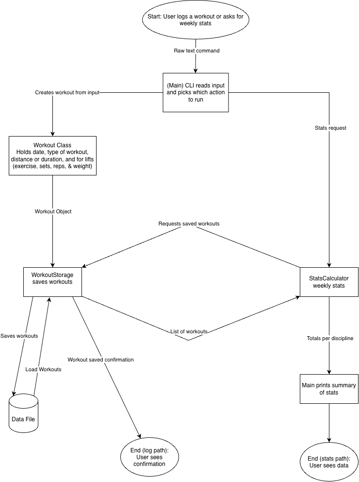

# Workout-Tracker

## Project Goal
A Java command-line tool for logging swim, bike, run, and strength workouts in one place and viewing weekly stats. (Replace with your own 1.1 and 1.2 text.)

## MVP Scope
- Log a workout (date, type, distance or duration) from the command line
- Save workouts to a local file and load them back
- Print weekly totals per discipline
- Log strength workouts (exercise, sets, reps, weight)

## Future Plans
- Training-load and trend tracking
- Edit or delete past workouts
- Personal records
- Charts of progress

## Tech Stack
- Java 17+, command line
- Java standard library (java.time, java.nio.file)
- JSON file storage
- JUnit for testing

## System Diagram

## Eisenhower Matrix
[Eisenhower Matrix](docs/eisenhower-matrix.pdf)
